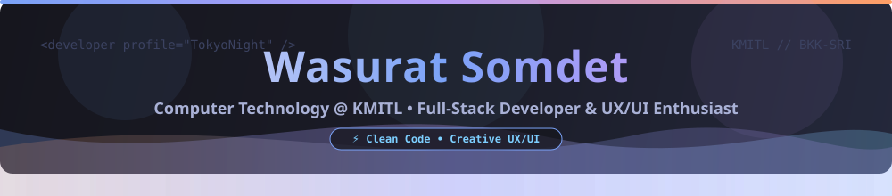
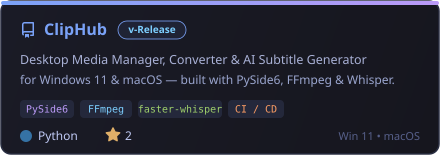
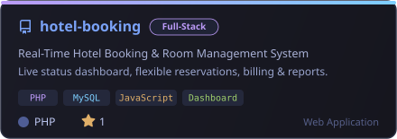
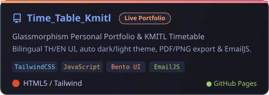
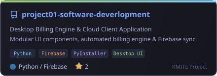
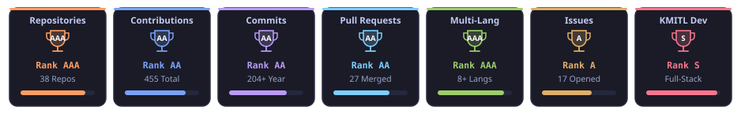
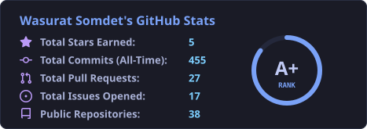
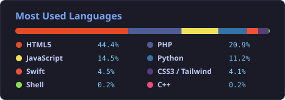
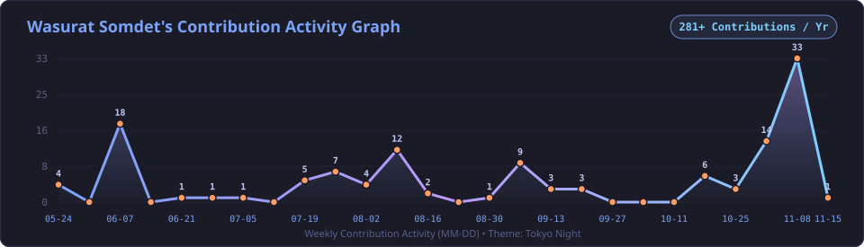

<!-- ==================== ANIMATED HEADER BANNER ==================== -->
<div align="center">
  

  <!-- ==================== ANIMATED TYPING SVG ==================== -->
  <a href="https://wasuratsomdet9009.github.io/Time_Table_Kmitl/portfolio_wasurat.html"></a>

  <!-- ==================== QUICK LINKS & PROFILE BADGES ==================== -->
  <p align="center">
    <a href="https://wasuratsomdet9009.github.io/Time_Table_Kmitl/portfolio_wasurat.html"></a>
    <a href="mailto:wasuratsomdet@gmail.com"></a>
    <a href="https://www.instagram.com/raiwa_gu_wasurat/"></a>
    <a href="https://discord.com/users/721665946795900980"></a>
    
  </p>
</div>

---

## 👨‍💻 About Me

```ts
const wasurat = {
  name: "Wasurat Somdet (นายวสุรัชต์ สมเด็จ)",
  education: "B.S.Ind.Ed. in Computer Technology @ KMITL",
  faculty: "Faculty of Industrial Education and Technology",
  location: "Saraburi / Bangkok, Thailand 🇹🇭",
  status: "🟢 Open to Internships & Junior Developer Opportunities",

  interests: [
    "Full-Stack Web Development (React, Node.js, PHP)",
    "Cross-Platform Desktop Apps (Python, PySide6, Swift)",
    "UX/UI Design, Glassmorphism & Interactive Web Experiences",
    "Live Streaming Systems (OBS) & Digital Media Production"
  ],

  currentFocus: "Building scalable full-stack web apps & AI-powered desktop tools",
  motto: "Clean code and intuitive UX/UI make every project not just functional, but delightful."
};
```

<details>
  <summary><b>✨ คลิกเพื่อดูข้อมูลเพิ่มเติมเกี่ยวกับผม (More About My Journey & Services)</b></summary>
  <br />

  - 🎓 **การศึกษา:** นักศึกษาสาขาวิชาเทคโนโลยีคอมพิวเตอร์ คณะครุศาสตร์อุตสาหกรรมและเทคโนโลยี **สถาบันเทคโนโลยีพระจอมเกล้าเจ้าคุณทหารลาดกระบัง (KMITL)**
  - 💡 **จุดเด่นในการทำงาน:** ผสมผสานทักษะด้านวิศวกรรมซอฟต์แวร์เข้ากับการออกแบบ **UX/UI** ที่สวยงาม ใช้งานง่าย และใส่ใจในโครงสร้างโค้ดที่สะอาด (Clean Code)
  - 🛠️ **สิ่งที่กำลังพัฒนา:** แอปพลิเคชันบนเว็บแบบเรียลไทม์ด้วย **React, Node.js, Firebase** และโปรแกรมเดสก์ท็อปที่ประยุกต์ใช้ **AI (Whisper / FFmpeg)**
  - 🌍 **รูปแบบการทำงาน:** สะดวกทั้งแบบ **Remote** และเดินทางในพื้นที่ **กรุงเทพฯ – สระบุรี**
  - 🔗 **ชมเรซูเม่และพอร์ตโฟลิโอแบบอินเทอร์แอคทีฟ:** [**Wasurat Somdet — Interactive Portfolio**](https://wasuratsomdet9009.github.io/Time_Table_Kmitl/portfolio_wasurat.html)
</details>

---

## 🛠️ Tech Stack & Tools

<div align="center">
  
</div>

<br />

<div align="center">

| หมวดหมู่ (Category) | เทคโนโลยีและเครื่องมือ (Technologies & Tools) |
| :--- | :--- |
| **💻 Frontend & UI/UX** |        |
| **⚙️ Backend & Database** |      |
| **🧠 Languages & Desktop** |      |
| **🚀 DevOps & Media** |     |

</div>

---

## 🚀 Featured Projects

<div align="center">
  <a href="https://github.com/wasuratsomdet9009/ClipHub"></a>
  <a href="https://github.com/wasuratsomdet9009/hotel-booking"></a>
  <br />
  <a href="https://wasuratsomdet9009.github.io/Time_Table_Kmitl/portfolio_wasurat.html"></a>
  <a href="https://github.com/wasuratsomdet9009/project01-software-deverlopment"></a>
</div>

<p align="center">
  <a href="https://wasuratsomdet9009.github.io/Time_Table_Kmitl/portfolio_wasurat.html"></a>
  <a href="https://github.com/wasuratsomdet9009/ClipHub/releases/latest"></a>
</p>

---

## 🏆 GitHub Trophies & Analytics

<div align="center">
  
</div>

<br />

<div align="center">
  
  
</div>

<div align="center">
  
</div>

---

## 📈 Contribution Activity & Snake Graph

<div align="center">
  
</div>

<div align="center">
  <picture>
    <source media="(prefers-color-scheme: dark)" srcset="https://raw.githubusercontent.com/wasuratsomdet9009/wasuratsomdet9009/output/github-contribution-grid-snake-dark.svg" />
    <source media="(prefers-color-scheme: light)" srcset="https://raw.githubusercontent.com/wasuratsomdet9009/wasuratsomdet9009/output/github-contribution-grid-snake.svg" />
    
  </picture>
</div>

---

## 🤝 Let's Connect

<div align="center">
  <a href="https://wasuratsomdet9009.github.io/Time_Table_Kmitl/portfolio_wasurat.html"></a>
  <a href="mailto:wasuratsomdet@gmail.com"></a>
  <a href="https://github.com/wasuratsomdet9009"></a>
  <a href="https://www.instagram.com/raiwa_gu_wasurat/"></a>
  <a href="https://discord.com/users/721665946795900980"></a>
</div>

<p align="center">
  <i>✨ "Keep learning. Keep building. Make every project delightful." ✨</i>
</p>

<!-- ==================== ANIMATED FOOTER BANNER ==================== -->
<div align="center">
  
</div>
